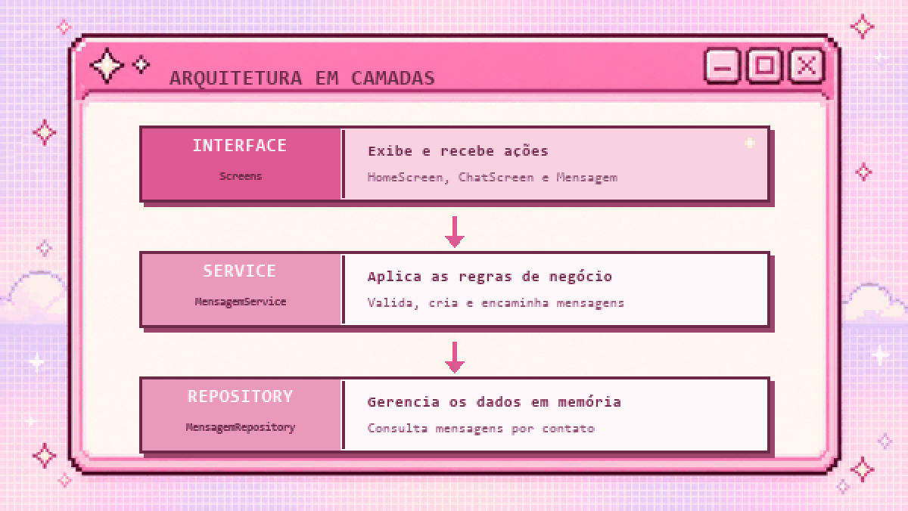

<div align="center">
  

  <br />

  
  
  
</div>

## O projeto

O **Astery Connect** foi desenvolvido para a atividade **“Desenvolvendo um APP de mensagens — Navegação e Organização em Camadas”**. O trabalho propõe a construção de um aplicativo simples de mensagens com React Native e Expo, priorizando navegação entre telas, passagem de parâmetros, componentes reutilizáveis e separação de responsabilidades.

Na aplicação, o usuário escolhe um contato, acessa a conversa correspondente e envia mensagens. Os dados são mantidos em memória e cada contato possui seu próprio histórico durante a execução do aplicativo.

> A identidade visual da aplicação ainda está em construção. A arte deste README apresenta o conceito retrô do projeto, não a interface final.

## Integrantes

<div align="center">
  
</div>

## Requisitos atendidos

| Requisito do trabalho | Implementação |
| --- | --- |
| Tela inicial | Exibe quatro contatos fictícios e permite abrir uma conversa |
| Navegação | Utiliza Stack Navigator e envia o identificador e o nome do contato pela rota |
| Tela de conversa | Apresenta o contato selecionado, a lista de mensagens, o campo de texto e o botão de envio |
| Validação | Impede o envio de mensagens vazias e limpa o campo após o envio |
| Componente reutilizável | `Mensagem` recebe o texto e o estado `recebida` para definir alinhamento e estilo |
| Service | Centraliza as regras para consultar, validar, criar e enviar mensagens |
| Repository | Armazena as mensagens em memória e filtra os dados pelo contato |
| Separação em camadas | A interface acessa os dados por meio do Service, sem consultar o Repository diretamente |

## Organização em camadas

<div align="center">
  
</div>

```text
astery-connect/
├── App.js                         # Configuração das rotas
├── src/
│   ├── components/
│   │   └── Mensagem.js            # Balão de mensagem reutilizável
│   ├── screens/
│   │   ├── HomeScreen.js          # Lista de contatos
│   │   └── ChatScreen.js          # Conversa e envio de mensagens
│   ├── services/
│   │   └── MensagemService.js     # Regras de negócio
│   └── repositories/
│       └── MensagemRepository.js  # Armazenamento em memória
└── package.json
```

O fluxo mantém a interface separada das regras de negócio e do armazenamento: as telas solicitam operações ao `MensagemService`, que valida os dados e se comunica com o `MensagemRepository`.

## Tecnologias

| Tecnologia | Uso no projeto |
| --- | --- |
| React Native | Construção das telas e dos componentes mobile |
| Expo | Ambiente de desenvolvimento e execução |
| React Navigation | Navegação em pilha entre contatos e conversa |
| JavaScript | Componentes, estado e regras da aplicação |

## Como executar

### Pré-requisitos

- Node.js instalado;
- npm;
- Expo Go no celular ou um emulador Android/iOS configurado.

### Instalação

```bash
git clone https://github.com/astery-studio/astery-connect.git
cd astery-connect
npm install
```

### Iniciar o projeto

```bash
npm start
```

Depois, leia o QR Code com o Expo Go ou use uma das opções exibidas no terminal. Para iniciar diretamente no Android ou iOS:

```bash
npm run android
npm run ios
```

> O comando para iOS requer macOS com o simulador configurado.

## Fluxo principal

1. A `HomeScreen` apresenta os contatos cadastrados localmente.
2. Ao abrir uma conversa, o identificador e o nome do contato seguem pela rota `Chat`.
3. A `ChatScreen` consulta no serviço apenas as mensagens daquele contato.
4. O serviço valida o conteúdo, cria a mensagem e solicita seu armazenamento ao repositório.
5. A lista é atualizada e o componente `Mensagem` define a aparência do balão.
